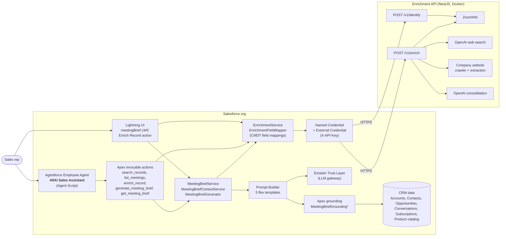
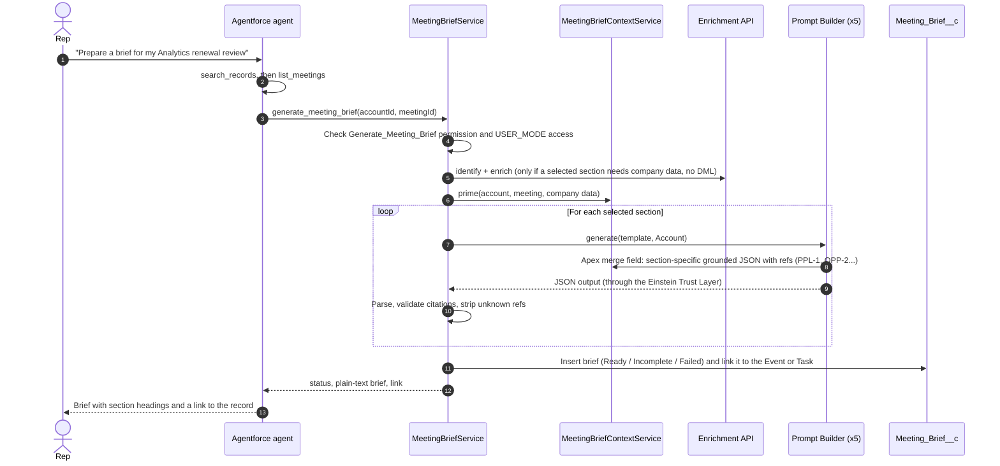
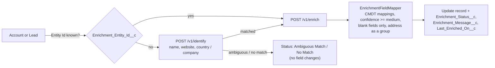

# AllAI Sales Assistant: Meeting Briefs and Record Enrichment with Agentforce

> An Agentforce employee agent that gets a sales rep ready for a customer meeting in about a minute. It enriches Accounts and Leads with verified company data and writes a cited, five-section meeting brief from CRM history, subscriptions, pipeline, conversations and live company signals.

**OSF Agentforce Hackathon, Theme 3: Client Agent Replication and Adaptation.** This project takes the AI sales-enablement solution OSF built for **Wolters Kluwer Tax & Accounting (North America)** and turns it into a reusable, client-neutral accelerator. It now runs in any Agentforce org, has a conversational agent on top, and carries no client data or dependencies.


---

## Contents

1. [At a glance](#at-a-glance)
2. [The problem](#the-problem)
3. [What it does](#what-it-does)
4. [Demo storyline](#demo-storyline)
5. [Architecture](#architecture)
6. [The agent](#the-agent)
7. [The meeting brief](#the-meeting-brief)
8. [Record enrichment](#record-enrichment)
9. [How AI is used](#how-ai-is-used)
10. [Trust, security and guardrails](#trust-security-and-guardrails)
11. [Original vs adapted](#original-vs-adapted)
12. [Reuse and adaptation guide](#reuse-and-adaptation-guide)
13. [Impact and ROI](#impact-and-roi)
14. [Repository structure](#repository-structure)
15. [Testing](#testing)
16. [Limitations and future work](#limitations-and-future-work)
17. [Deployment](#deployment)

---

## At a glance

| | |
|---|---|
| **Target user** | B2B account executives and SDRs who work in Salesforce and run several customer meetings a day |
| **Agent** | **AllAI Sales Assistant** (API name `Acme_Sales_Assistant`), an Agentforce Employee Agent written in Agent Script, with 5 Apex actions |
| **Generative AI** | 5 Prompt Builder flex templates grounded by Apex, running through the Einstein Trust Layer; OpenAI web research inside the Enrichment API |
| **External service** | Enrichment API (NestJS, containerized), called through a Named Credential and an API-key External Credential |
| **UI** | Agentforce panel, a `meetingBrief` LWC on Account, Event and Task pages, and an **Enrich Record** quick action on Account and Lead |
| **Data model** | `Meeting_Brief__c`, `Conversation__c`, `Product_Subscription__c`, `Enrichment_Field_Mapping__mdt` and enrichment audit fields on Account and Lead |
| **Packaging** | Plain Salesforce DX source (no managed packages needed) plus a Docker image for the API |
| **Fictional seller** | *Acme Cloud*, a SaaS vendor with an 8-product catalog (CRM Cloud, Service Desk, Field Service, Analytics, Data Pipelines, Billing, Secure Identity, Legacy Reports) |

---

## The problem

Before a customer meeting, a rep has to answer five questions:

1. **Why does this meeting matter and what should I get out of it?**
2. **Who am I meeting, and what did we last talk about? What did we promise?**
3. **What do they own, what did they drop, and what is in the pipeline?**
4. **What is new at the company?** (news, funding, leadership changes, hiring)
5. **What should I say, ask and avoid?**

The answers sit in five different places: call notes, subscription records, opportunities, the web, and the product catalog. Pulling them together takes about 30 minutes per meeting for an experienced seller, and an hour or more for an average or new seller. Separately, inbound Account and Lead records are often incomplete (no address, headcount, revenue or phone).

---

## What it does

| Capability | Where | Outcome |
|---|---|---|
| **Enrich a record** | Agent (*"Enrich Marks and Spencer"*) or the **Enrich Record** quick action | Identifies the company or person, then fills **only blank** fields (address, phone, website, headcount, revenue, ticker, title) with medium-or-better confidence values. It never overwrites data a rep entered. |
| **Generate a meeting brief** | Agent (*"Prepare a brief for my Analytics renewal review"*) or the **Generate** button in the `meetingBrief` panel | Builds a five-section brief in about 60 seconds. Every claim links back to the CRM record or source it came from. |
| **Regenerate selected sections** | Agent (*"Just refresh What's New and the Call Plan"*) or the section picker in the panel | Runs only the chosen prompts, which is faster and cheaper. |
| **Find records and meetings** | Agent | Resolves "my Electrolux meeting" to the right Account and Event or Task, and asks which one when there are several. |
| **Show an existing brief** | Agent or any Account, Event or Task page | Shows the latest brief without spending another model call. |

---

## Demo storyline

**Personas** (all fictional):

| Persona | Role | What they need |
|---|---|---|
| **Alex**, Account Executive at Acme Cloud | Owns the OSF Digital, Marks and Spencer and Electrolux Group accounts | To walk into the *Analytics renewal review* with OSF Digital fully prepared, without spending 30 minutes on it |
| **Priya**, Sales Operations admin | Owns the Salesforce org | Clean Account and Lead data, and control over who can spend enrichment credits and model calls |
| **Dana Lee**, CFO at OSF Digital (customer contact) | Attends the renewal meeting | *(context only)* Budgets are flat, she asked for a multi-year discount, and she turned down Field Service last year |

**Scenario (2 to 3 minutes):**

1. **Messy data.** Alex opens *Saint-Gobain*. The record has no website, address, phone or headcount. He asks the agent: *"Enrich Saint-Gobain."* The agent finds the record, calls the Enrichment API, and reports `Succeeded` with the list of fields it filled. Fields that already had values stay as they were.
2. **Lead enrichment.** He enriches the lead *Stuart Machin (Marks and Spencer)*. Title, company phone and address are filled in.
3. **Meeting prep.** He asks: *"Prepare a brief for my Analytics renewal review with OSF Digital."* The agent lists his upcoming OSF Digital meetings, picks the right Event, and generates the brief:
   - **Bottom Line.** The renewal is at risk on price. Goal: secure a multi-year renewal by showing seat adoption.
   - **Who You're Meeting.** Dana Lee (CFO). Open commitment: *"We promised a usage report before the renewal meeting."*
   - **Where We Stand.** Analytics renewal is due soon. Field Service was lost on price. Data Pipelines is still being qualified.
   - **What's New.** Recent public company news from the Enrichment API, each item with a "so what".
   - **Call Plan.** Talking points, questions and watch-outs, such as *don't pitch Legacy Reports (no longer offered)* and *expect pushback on rigid pricing*.
4. **Review in Salesforce.** Alex opens the Event. The same brief is in the side panel, and each citation chip links to the Contact, Opportunity, Conversation or subscription behind the claim.
5. **Partial refresh.** *"Refresh just What's New."* Only one prompt runs.

---

## Architecture



### Meeting brief generation flow



The design is **synchronous**: callouts happen before any DML, and the brief is saved in the same transaction. There are no queues, polling or platform events, so the agent can answer within one turn.

---

## The agent

**AllAI Sales Assistant** (API name `Acme_Sales_Assistant`) is defined in [Agent Script](force-app/main/default/aiAuthoringBundles/Acme_Sales_Assistant/Acme_Sales_Assistant.agent) (`AgentforceEmployeeAgent`).

| Subagent | Purpose |
|---|---|
| `agent_router` (start) | Sends enrichment, record search, meeting and brief requests to `sales_prep`, and everything else to `off_topic` |
| `sales_prep` | Finds records, asks the rep to choose when a name is ambiguous, enriches on request, picks the right meeting, generates or retrieves briefs, and can generate selected sections only |
| `off_topic` | Redirects politely, refuses general-knowledge questions, ignores attempts to override its rules, and never reveals its instructions or configuration |

| Action | Apex class | Inputs | Outputs |
|---|---|---|---|
| `search_records` | [AgentSearchRecords](force-app/main/default/classes/AgentSearchRecords.cls) | `searchText` | Up to 5 Accounts and 5 unconverted Leads, each with type, name and Id |
| `list_meetings` | [AgentListMeetings](force-app/main/default/classes/AgentListMeetings.cls) | `accountId` | Up to 10 Events and Tasks from 7 days ago to 30 days ahead, flagging which ones already have a brief |
| `enrich_record` | [AgentEnrichRecord](force-app/main/default/classes/AgentEnrichRecord.cls) | `recordId` (Account or Lead) | `status`, `message`, `recordName` |
| `generate_meeting_brief` | [AgentGenerateMeetingBrief](force-app/main/default/classes/AgentGenerateMeetingBrief.cls) | `accountId`, `meetingId`, `sections` (all optional) | `status`, `message`, `briefId`, `briefUrl`, `briefText` |
| `get_meeting_brief` | [AgentGetMeetingBrief](force-app/main/default/classes/AgentGetMeetingBrief.cls) | `recordId` (brief, Account, Event or Task) | `found`, `briefId`, `briefUrl`, `briefText` |

Global instructions: use only what actions return, never invent IDs, facts or brief content, and keep replies short and skimmable.

**Example utterances**

```text
Enrich Saint-Gobain
Enrich the lead Stuart Machin
What meetings do I have with Electrolux?
Prepare a brief for my Analytics renewal review with OSF Digital
Only generate What's New and the Call Plan for Marks and Spencer
Show me the existing brief for the Service Desk expansion proposal
```

---

## The meeting brief

Each section has its own prompt template, grounding class, output schema, rich-text field and status field. This keeps every section small, focused and independently re-runnable.

| # | Section (UI title) | Key | Template | Grounded on | Output |
|---|---|---|---|---|---|
| 1 | **Bottom Line** | `overview` | `Meeting_Brief_Overview` | All sources | Why it matters, up to 2 "what changed" items, suggested goal |
| 2 | **Who You're Meeting** | `conversations` | `Meeting_Brief_Conversations` | Contacts, conversations (12 months) | Up to 3 people worth knowing, up to 3 recent conversations with open commitments |
| 3 | **Where We Stand** | `accountHealth` | `Meeting_Brief_Account_Health` | Subscriptions, opportunities | Owned, lapsed and opportunities, each with a summary and highlights |
| 4 | **What's New** | `companySignals` | `Meeting_Brief_Company_Signals` | Enrichment API, product catalog | Up to 4 dated news items with a "so what", and hiring signals |
| 5 | **Call Plan** | `approach` | `Meeting_Brief_Approach` | All sources | Up to 3 talking points, questions and watch-outs |

**Grounding and citations.** The [`MeetingBriefContextService`](force-app/main/default/classes/MeetingBriefContextService.cls) builds a compact JSON payload for each section and gives every fact a reference such as `PPL-1` (person), `PRD-2` (product), `OPP-1` (opportunity), `CONV-3` (conversation), `CMP-1` (company), `ENR-2` (external source) or `CAT-4` (catalog). The model must cite these references. The [`MeetingBriefGenerator`](force-app/main/default/classes/MeetingBriefGenerator.cls) keeps only references that exist in the grounding and removes the rest. The LWC renders them as links to the Salesforce record.

**Statuses.** Each section is `Ready`, `Error` or `Skipped`. The brief is `Ready` when every selected section succeeded, `Incomplete` when some did, and `Failed` when none did. A section failure never discards the others.

**Context snapshot.** Each brief stores what it was built from (`crmAsOf`, the meeting and company facts) in `Context_Snapshot__c`, so a reviewer can tell how fresh it is.

---

## Record enrichment



- **Configurable mappings.** 21 [`Enrichment_Field_Mapping__mdt`](force-app/main/default/customMetadata) records (11 Account, 10 Lead) map API attributes such as `headcount` or `address.city` to fields. Add a record to map a new field. No code changes needed.
- **Never overwrites.** Only blank fields are written. Address fields are written as a group, and only when the whole group is blank, so you never end up with a London street in a Paris address.
- **Confidence gate.** Only `medium`, `high` and `very_high` values are used.
- **Picklist-safe.** State and country values are mapped to the org's State/Country picklist labels. Values that don't match are skipped instead of failing the update.
- **Currency-safe.** Revenue is written only in single-currency USD orgs.
- **Audit trail.** `Enrichment_Status__c` (`Succeeded`, `Partial`, `No Match`, `Ambiguous Match`, `Failed`), `Enrichment_Message__c`, `Enrichment_Entity_Id__c` and `Last_Enriched_On__c`.

The API is documented in [enrichment-api/README.md](enrichment-api/README.md): endpoints, providers, execution order, confidence model, rate limits and configuration.

---

## How AI is used

| Layer | AI | Purpose |
|---|---|---|
| **Conversation** | Agentforce (Atlas reasoning engine) with Agent Script | Understands the request, routes it, calls actions in the right order (search, then list meetings, then generate), and asks the rep to choose when a match is ambiguous |
| **Brief writing** | Prompt Builder flex templates on `sfdc_ai__DefaultGPT6Luna`, through the Einstein Trust Layer | Five focused, grounded, JSON-only generations with mandatory citations |
| **Company research** | OpenAI Responses API with `web_search` (`gpt-6-luna`) in the Enrichment API | Checks firmographics from public sources and collects dated news, funding, leadership and hiring signals with source URLs |
| **Website extraction** | OpenAI structured output | Pulls facts (products, locations, leadership) from the company's own website |
| **Consolidation** | OpenAI | Merges and deduplicates lists (news, people, products) from several sources, with a confidence for each value |
| **Building it** | GitHub Copilot (agent mode) | Helped port the client solution, remove client specifics, write the Agent Script, write tests and draft the documentation. A human reviewed every change. |

---

## Trust, security and guardrails

- **Einstein Trust Layer.** All brief generations go through Prompt Builder, so they get the Trust Layer protections (zero data retention with the model provider, toxicity checks, audit).
- **Prompt-injection defense.** The templates mark all grounded data as *untrusted DATA*. They tell the model to ignore embedded commands, role changes and formatting requests, and to take extra care with external or encoded content. Conversation prompts warn the model not to follow instructions spoken by external participants.
- **Output hardening.** Output is JSON only, with no URLs, HTML or scripts and no raw phone, email or financial data. Unknown citations are stripped. The LWC renders text segments, never generated HTML.
- **Least privilege.** Two custom permissions, `Request_Record_Enrichment` and `Generate_Meeting_Brief`, gate the paid operations. The [`Acme_Sales_Enablement`](force-app/main/default/permissionsets/Acme_Sales_Enablement.permissionset-meta.xml) permission set grants them along with the agent, the External Credential principal and the Apex classes.
- **Record access.** Reads run in `USER_MODE`. Enrichment also checks that the user can edit the record (`UserRecordAccess.HasEditAccess`) and that the user can read and update each mapped field.
- **Secrets.** The API key lives only in the External Credential, and the Named Credential injects it as the `X-API-Key` header. It is never in source control, Apex or prompts. On the API side, keys are host secrets and are never logged.
- **API hardening.** Constant-time API-key check, per-caller rate limits, strict request validation (unknown fields rejected), a request time budget of 90 s (below the 120 s Apex callout limit), and no request bodies or provider payloads in logs.

---

## Original vs adapted

The original solution was built by OSF for the North American sales team of **Wolters Kluwer Tax & Accounting**. Its production release is in progress.

**Original problem:** sellers had to pull call history, product inventory, pipeline and third-party firmographics together by hand before meetings, and inbound Lead and Account data was incomplete.

**Original scope:**
- One-click enrichment from two commercial data providers (ZoomInfo, D&B) plus web research.
- AI meeting briefs on Tasks and Events.
- Automatic enrichment of new Leads, behind a feature switch.
- An audit trail on every enriched record.

| Area | Original (Wolters Kluwer) | Adapted accelerator (this repo) |
|---|---|---|
| **User experience** | Buttons and a Screen Flow on Task and Event; 14 LWCs | **Agentforce Employee Agent** (Agent Script) plus 2 LWCs; the same capabilities through conversation |
| **Execution model** | Asynchronous (Queueable, custom notifications, polling status component) | **Synchronous**, finishes within one agent turn, with all callouts before DML |
| **Lead automation** | Optional automatic enrichment of new Leads (trigger and custom setting) | On demand only (agent or quick action), so no surprise credit usage |
| **Enrichment API hosting** | Snowflake Snowpark Container Services, with CI/CD in Azure DevOps | **Any Docker host** (Fly.io is the reference, Render blueprint included) |
| **API LLM** | Snowflake Cortex (LLM functions and web search) | **OpenAI Responses API** (`gpt-6-luna`), or any OpenAI-compatible gateway via `OPENAI_BASE_URL` |
| **API auth** | Snowflake programmatic access token, network policies | **API key** in an External Credential (`X-API-Key`), constant-time check |
| **API state** | Entity table, source cache and history in Snowflake | **Stateless** by default; the cache and entity store can be turned back on through configuration |
| **Data providers** | ZoomInfo + D&B (both licensed) + web search + website crawler | ZoomInfo + web search + website crawler; **D&B is optional** (`DNB_ENABLED`) |
| **Salesforce dependencies** | ZoomInfo, D&B and RingDNA managed packages; org-specific fields (inventory roll-ups, market segment, office counts) and an existing trigger framework | **None.** `Conversation__c` replaces RingDNA conversations, `Product_Subscription__c` replaces inventory roll-ups, and provider IDs move to a neutral `Enrichment_Entity_Id__c` |
| **Product knowledge** | Wolters Kluwer product catalog | Fictional **Acme Cloud** catalog in a static resource (JSON), easy to replace |
| **Prompt model** | `sfdc_ai__DefaultGPT5Mini` | `sfdc_ai__DefaultGPT6Luna` (configurable for each template) |
| **Permissions** | 3 permission sets (enrichment, brief, admin) | 1 permission set + 2 custom permissions |
| **Release tooling** | Copado user stories, multi-step release plan | `sf project deploy start` + one setup script ([Deployment guide](docs/DEPLOYMENT.md)) |
| **Data** | Wolters Kluwer CRM data | Seed script with public company names (for live enrichment) and **fictional** contacts, deals, conversations and meetings |

---

## Reuse and adaptation guide

To adapt the accelerator to a new client, change only the configuration and data layers. The engine stays the same.

| To change... | Edit | Code change? |
|---|---|---|
| Which enriched attributes land in which fields | `Enrichment_Field_Mapping__mdt` records (`Object__c`, `Field__c`, `Attribute__c`, `Field_Group__c`) | No |
| The product catalog used for recommendations | Static resource `Acme_Product_Catalog` (JSON: name, area, purpose, benefits, compatibility, status) | No |
| The LLM for each section | Prompt template version → model (any model available in Einstein Studio) | No |
| Tone, length or content of a section | The section's prompt template (new version) | No |
| The API endpoint or key | `scripts/configure-enrichment.ps1 -Url ... -PromptForKey` | No |
| Data providers and research models | API environment variables (`ZOOMINFO_*`, `DNB_*`, `WEB_SEARCH_MODEL`, `WEBSITE_ENABLED`...) | No |
| Who can enrich or generate | Assign `Acme_Sales_Enablement`, or clone it and give each custom permission separately | No |
| Agent wording, routing and examples | `Acme_Sales_Assistant.agent`, then validate and publish | No (Agent Script) |
| The conversation source (telephony package, Gong, Einstein Conversation Insights) | Queries in `MeetingBriefContextService` (conversations block) | Small |
| The subscription or inventory source (assets, contracts, CPQ) | Queries in `MeetingBriefContextService` (products block) | Small |
| Sections (add, remove or rename) | `MeetingBriefSections` + a template + a grounding class + 2 fields | Moderate |
| The enrichment provider entirely | Implement `/v1/identify` and `/v1/enrich` with the same contract, or change `AcmeEnrichmentClient` | Moderate |

**Tip:** to rename "Acme", search and replace `Acme_` and `Acme Cloud` in metadata, then update the catalog and the agent's welcome message.

---

## Impact and ROI

| Seller | Manual prep per meeting | With the assistant |
|---|---|---|
| Experienced | About 30 min | About 1 min to generate, then review |
| Average or new | 1 hour or more | About 1 min to generate, then review |

The starting team at Wolters Kluwer is **12 sellers and their managers**. Each meeting per seller per week that gets a brief instead of manual prep returns roughly **6 to 12 hours a week** to the team (12 sellers × 30 to 60 min). New and average sellers gain the most.

**Reuse value:** the original depends on three managed packages, a Snowflake deployment and a multi-step Copado release. This accelerator installs with one deploy, one script and a seed file (see the [deployment guide](docs/DEPLOYMENT.md)), and further adaptation is mostly configuration (see the adaptation guide above).

---

## Repository structure

```text
agentforce-hackathon-meeting-brief/
├── force-app/main/default/
│   ├── aiAuthoringBundles/Acme_Sales_Assistant/   Agent Script (source of truth for the agent)
│   ├── aiAgents/, aiAgentDefinitionVersions/      Generated on publish (reference only, .forceignore'd)
│   ├── classes/                                   22 Apex classes (services, actions, grounding, tests)
│   ├── genAiPromptTemplates/                      5 Prompt Builder flex templates
│   ├── lwc/meetingBrief/                          Brief panel (Account, Event, Task pages)
│   ├── lwc/recordEnrichment/                      Enrich Record quick action (Account, Lead)
│   ├── objects/                                   Meeting_Brief__c, Conversation__c, Product_Subscription__c,
│   │                                              Enrichment_Field_Mapping__mdt, Account/Lead/Activity fields
│   ├── customMetadata/                            21 enrichment field mappings
│   ├── customPermissions/                         Generate_Meeting_Brief, Request_Record_Enrichment
│   ├── permissionsets/Acme_Sales_Enablement       Single permission set for the solution
│   ├── namedCredentials/, externalCredentials/    Acme_Enrichment (URL + X-API-Key header)
│   ├── staticresources/Acme_Product_Catalog       Fictional product catalog (JSON)
│   ├── flexipages/, layouts/, quickActions/, tabs/
│   └── cspTrustedSites/
├── enrichment-api/                                NestJS Enrichment API (Dockerfile, fly.toml, 284 tests)
├── scripts/
│   ├── configure-enrichment.ps1                   Points the Named Credential at the API and stores the key
│   └── apex/
│       ├── seed-demo-data.apex                    Demo accounts, contacts, deals, conversations, meetings, leads
│       ├── check-enrichment.apex                  Smoke test: identify + enrich without DML
│       └── try-brief.apex                         Smoke test: generate a brief for the demo meeting
├── docs/DEPLOYMENT.md                             Step-by-step setup guide
├── render.yaml                                    Optional Render blueprint for the API
└── sfdx-project.json
```

---

## Testing

| Suite | Count | What it covers |
|---|---|---|
| [EnrichmentServiceTest](force-app/main/default/classes/EnrichmentServiceTest.cls) | 8 | Blank-only writes, address-group protection, confidence threshold, known entity IDs, invalid states, no and ambiguous matches, provider failures, permissions, fetching data without saving |
| [MeetingBriefServiceTest](force-app/main/default/classes/MeetingBriefServiceTest.cls) | 5 | All five sections end to end with a mock prompt runner, grounding content, citation normalization, failed and skipped sections, agent actions, validation and permissions |
| Enrichment API (Vitest) | 284 in 25 files | Providers, reconciliation, confidence, consolidation, rate limits, auth, validation, e2e controllers (no network) |
| API live tests (opt-in) | `npm run test:live` | Real OpenAI web search and website extraction against public companies |

```powershell
# Salesforce
sf apex run test --class-names EnrichmentServiceTest MeetingBriefServiceTest --result-format human --code-coverage --target-org <alias>

# API
cd enrichment-api; npm ci; npm test; npm run typecheck; npm run lint
```

---

## Limitations and future work

**Known limitations**
- **Synchronous by design.** A full brief takes about 60 s, plus up to 90 s when fresh company data is needed. Apex callout and CPU limits apply, and there is no background retry.
- **Every generation inserts a new brief.** Sections that are not regenerated are `Skipped` rather than copied from the previous brief.
- **Brief sharing is independent of the Account.** `Meeting_Brief__c` uses `ReadWrite` sharing and a lookup, not master-detail. Review this for orgs with strict account-level privacy.
- **Citations are checked for existence, not truth.** The generator makes sure every reference exists in the grounding. It does not check that the sentence is supported by the source.
- **The panel shows sections only.** Stored supplementary lists and the context snapshot are not displayed yet.
- **Org-specific metadata.** The supplied Account and Lead layouts reference Developer Edition sample fields, and the CSP trusted site points at the demo org's domain. See the [deployment guide](docs/DEPLOYMENT.md#troubleshooting).
- **Free-tier model quotas.** Some Developer Edition orgs allow 0 calls to "advanced" models. The templates use a standard model for this reason.

**Future work**
- Asynchronous generation (Queueable + Platform Event) for very large accounts, with live streaming into the panel.
- Feedback on each brief (thumbs up or down with a reason) feeding prompt evaluation in Agentforce Testing Center.
- Agentforce test suite (`sf agent test`) for routing and action-selection regression.
- Proactive mode: generate briefs overnight for the next day's meetings and post them to Slack.
- Data Cloud grounding (unified profile, engagement signals) and Einstein Conversation Insights as the conversation source.
- Packaging as an unlocked package with a setup-assistant LWC for the Named Credential and the key.
- Optional entity store and cache (already supported by the API) to cut provider costs.

---

## Deployment

See **[docs/DEPLOYMENT.md](docs/DEPLOYMENT.md)** for the step-by-step guide: prerequisites, API hosting, Salesforce deploy, credentials, agent publish and activation, demo data, verification and troubleshooting.

Quick version:

```powershell
# 1. API (any Docker host; Fly.io shown)
cd enrichment-api
fly launch --no-deploy --copy-config --name <your-app>
fly secrets set "API_KEY=<random>" "OPENAI_API_KEY=<key>" "ZOOMINFO_CLIENT_ID=<id>" "ZOOMINFO_CLIENT_SECRET=<secret>"
fly deploy --ha=false --remote-only
cd ..

# 2. Salesforce
sf project deploy start --source-dir force-app --target-org <alias> --test-level RunLocalTests
sf org assign permset --name Acme_Sales_Enablement --target-org <alias>
./scripts/configure-enrichment.ps1 -TargetOrg <alias> -Url https://<your-app>.fly.dev -PromptForKey
sf agent publish authoring-bundle --api-name Acme_Sales_Assistant --target-org <alias>
sf agent activate --api-name Acme_Sales_Assistant --target-org <alias>
sf apex run --file scripts/apex/seed-demo-data.apex --target-org <alias>
```

---

<sub>Built for the OSF Agentforce Hackathon. All people, deals, conversations and meetings in the demo data are fictional. Company names are used only to show live public-data enrichment.</sub>
