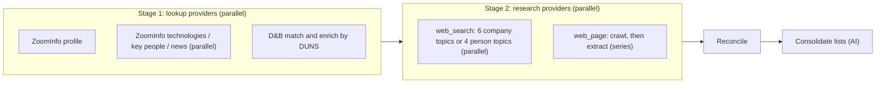

# Enrichment API

A NestJS service that identifies companies and people and enriches them with data from several sources. Every value in a response carries a confidence level and the sources it came from.

| Endpoint | Purpose |
| --- | --- |
| `POST /v1/identify` | Finds the company or person and returns an `entityId` (only when a source matched), a `matchConfidence` and the candidates of any source that found several. |
| `POST /v1/enrich` | Takes an `entityId` and returns the reconciled attributes, one outcome per data source, and warnings. |
| `GET /health` | Reports whether the upstream data sources are reachable. It always returns HTTP 200 with `status: ok \| degraded`. |

# API

Requests and responses are JSON. Every `/v1/*` request needs the `X-API-Key` header with the value of `API_KEY` (401 otherwise; `/health` and `/hello` are public). Fields that are `null` or blank count as absent, and unknown fields are rejected. A caller can send an `X-Correlation-Id` header (up to 64 letters, digits or `._:-`); it is echoed back, and a new one is generated when it is missing.

## `POST /v1/identify`

| Field | Required | Max length | Used for |
| --- | --- | --- | --- |
| `entityType` | Yes | | `company` or `person` |
| `name` | Yes | 300 | Company name, or the person's full name |
| `website` | No | 2048 | An http(s) URL or a bare domain (`example.com`). For a person, the employer's website. The strongest company identifier: ZoomInfo searches by it instead of the name |
| `address` | No | 500 | Used for companies only. Only the country at the end is read (`Quebec, QC, Canada` gives Canada): it narrows the ZoomInfo name search and lets D&B match without a website. English country names, `USA`, `US`, `UK` and `U.K.` are recognised; other two-letter codes are not (`CA` may be California) |
| `company` | No | 300 | Persons only: the employer's name |

```json
{ "entityType": "company", "name": "OSF Digital", "website": "osf.digital", "address": "Quebec, QC, Canada" }
```

What each lookup provider does with the input:
- **ZoomInfo**, for a company, searches by website when one is given, otherwise by name (narrowed to the country, if any). It then picks the match as shown under [Match confidence](#match-confidence-identify). For a person, it searches by full name, scoped to the employer's website or name.
- **D&B** (companies only) sends the name, the website's host and the country. It is skipped with `unavailable: insufficient_input` when there is neither a website nor a recognised country.

How the response is built:
1. **Status.** `matched` when any provider matched, otherwise `ambiguous` when any provider found several candidates, otherwise `no_match`.
2. **Match.** The first provider that matched (ZoomInfo, then D&B) sets the match. The other provider's match is added (its ID and any missing fields) when its website is the same. When either website is unknown, it is added only if it is `high` or `very_high`, so a weak match can't attach a wrong ID. Websites are compared by registrable domain: `shop.example.com` and `example.com` are the same site, `example.co.uk` is not. A provider whose only candidate has the match's website is added too.
3. **`entityId`.** Set only when the status is `matched` (see [Entity IDs](#entity-ids)). It is what `/v1/enrich` takes.
4. **`matchConfidence`.** The highest among the matches that were kept. Each provider's own is in `providers[].matchConfidence`. A `low` or `medium` match deserves a look before it drives a CRM update.
5. **`candidates`.** The candidates of every ambiguous provider that wasn't added to the match, even when the status is `matched`, so a weak match can be checked against the alternatives. Each candidate has its own `entityId`, its IDs, name, website, location (and employer and job title for a person) and the provider it came from.

## `POST /v1/enrich`

Send either an `entityId`, or a `zoomInfoId` and/or a `dunsNumber`:

| Field | Required | Format | Used for |
| --- | --- | --- | --- |
| `entityId` | Either this one | From Identify (match or candidate) | Every provider whose ID it carries: ZoomInfo, D&B or both |
| `zoomInfoId` | Or this one and/or `dunsNumber` | Digits | ZoomInfo |
| `dunsNumber` | Or this one and/or `zoomInfoId` | 9 digits | D&B; always a company |
| `entityType` | No | `company` or `person` | Defaults to `company`. With `entityId`, it must match the type of the entity |
| `refresh` | No | `true` or `false` | `true` skips the cache and asks every source again (see [Caching and history](#caching-and-history)) |

```json
{ "entityId": "ent_3f2b8c1e-5a4d-4e8f-9b2a-7c6d5e4f3a21" }
{ "zoomInfoId": "483396715", "dunsNumber": "246668123" }
```

With both IDs, each provider enriches its own record, and the values are reconciled as if they describe the same company: the caller is responsible for that.

With a `zoomInfoId` or `dunsNumber`, the response has the `entityId` of the entity that has the ID, and the entity's other ID is used too. When no entity has it yet, one is created once a provider finds the entity.

The research providers then use the name, website and employer that the lookup providers found (see [Execution order](#execution-order)).

## Errors

| HTTP | `error` | When |
| --- | --- | --- |
| 400 | `invalid_request` | The body is invalid; `details` lists every problem |
| 404 | `not_found` | Enrich: a provider answered, but none found the entity; or the `entityId` was never issued |
| 429 | `rate_limited` | The caller sent too many requests (see [Rate limits](#rate-limits)), or every provider is rate limited or out of quota; `Retry-After` is set when known |
| 502 | `upstream_failed` | Every provider failed |
| 503 | `no_provider_available` | No provider is configured, or none can use the input |
| 503 | `entity_store_unavailable` | The entity table can't be read or written |
| 504 | `timeout` | Every provider timed out |

Error bodies also have `providers`, with one outcome per source. Identify returns 200 with `status: no_match` when the providers answered but found nothing.

## Rate limits

Each caller gets its own limit per endpoint. The caller is the user in the `Sf-Context-Current-User` header, or the client IP when the header is missing.

| Endpoint | Default | Variable |
| --- | --- | --- |
| `POST /v1/identify` | 120 requests per minute | `RATE_LIMIT_IDENTIFY_PER_MINUTE` |
| `POST /v1/enrich` | 30 requests per minute | `RATE_LIMIT_ENRICH_PER_MINUTE` |

- A caller can send the whole minute's limit at once; after that, requests are allowed at an even pace (every 2 s for Enrich by default).
- Over the limit, the API answers `429 rate_limited` with an empty `providers` list and a `Retry-After` header, without calling any source.
- `0` turns the limit off. `/health` is not limited.
- Counters are kept in memory, so each service instance applies the limit on its own and a restart resets them.

## Entity IDs

Each company or person gets one internal `entityId` (`ent_` and a UUID), mapped to its ZoomInfo ID and DUNS number in an optional Snowflake hybrid table (`ENTITY_STORE_TABLE`, queried with the `SNOWFLAKE_WAREHOUSE` warehouse; its DDL is not part of this repository). Identify returns the existing entity when one has the ZoomInfo ID or the DUNS number of the match, adds the IDs it was missing, or creates one.

- **A failed provider's ID is added later.** When a provider fails, the entity is stored without its ID, and the next Identify that gets it adds it. Until then, Enrich by that `entityId` can't use that provider.
- **Merges.** When the ZoomInfo ID and the DUNS number of a match belong to two entities, the older one keeps both IDs and the newer one redirects to it. Enriching the newer `entityId` returns the older one: store it instead. An `entityId` stays valid forever. Two concurrent Identifies of a new company can each create an entity; the next Identify merges them the same way.
- **Candidates** of an ambiguous Identify get stateless IDs that encode their provider IDs; they are not stored, and `/v1/enrich` accepts them.

Without `ENTITY_STORE_TABLE`, every `entityId` is stateless like the candidates' ones.

# Data sources

The sources are split into two kinds:
- **Lookup providers** find the entity by identifier in a commercial database.
- **Research providers** build on what the lookup providers found.

| Source (`provider`) | Kind | What it provides | Entities | Enabled when |
| --- | --- | --- | --- | --- |
| **ZoomInfo** (`zoominfo`) | Lookup | Search (Identify) and enrich (Enrich): firmographics, estimated headcount and revenue, technologies, key people, news; for people: contact details and employer. | Company, person | ZoomInfo client credentials are set |
| **Web search** (`web_search`) | Research | OpenAI Responses API with the `web_search` tool (`WEB_SEARCH_MODEL`, default `gpt-6-luna`). It checks the ZoomInfo values against public sources and fills the gaps. It runs several prompts, one per topic (see [prompts/web-search](prompts/web-search)). | Company; person only when the employer is known | `OPENAI_API_KEY` is set |
| **Company website** (`web_page`) | Research | Crawls the company's own website, then an OpenAI model (`WEBSITE_EXTRACTION_MODEL`) extracts facts from the pages in one structured-output call (see [prompts/website](prompts/website)). Social profiles come from the page links, without the model. | Company only, when a website is known | `OPENAI_API_KEY` is set and `WEBSITE_ENABLED` is not `false` |
| **D&B** (`dnb`) | Lookup | Direct+ "match and enrich": one call finds the best match and returns its data: DUNS number, name, website, phone, address, industry, headcount, revenue (for ultimate parents). Identify needs a website, or a country at the end of the address (e.g. `Redmond, WA, USA`). Enrich uses the DUNS number. Every call consumes D&B credits. | Company only | `DNB_CLIENT_ID` and `DNB_CLIENT_SECRET` are set and `DNB_ENABLED` is not `false` |

Every response lists one outcome per source:
- `ok`, `partial`, `no_match`
- `failed` with an error code such as `timeout`, `blocked` or `upstream_unavailable`
- `unavailable` (`not_configured` / `not_integrated`, or `insufficient_input` when Identify lacks what the source needs)

So a caller can tell missing data apart from a source that failed or isn't configured. In Identify, each outcome also has the source's own `matchConfidence` (`null` unless it found a match).

# Execution order

**Identify** calls only the lookup providers, in parallel: a ZoomInfo search and a D&B match. It never runs the research providers. See [`POST /v1/identify`](#post-v1identify) for how the response is built.

**Enrich** runs in two stages, one after the other, within a single request budget (`ENRICHMENT_REQUEST_BUDGET_MS`, default 90 s, max 120 s):



1. **Stage 1: lookup providers, in parallel.** The research providers need what this stage finds (name, website, employer, known facts), so stage 2 starts only once it is done.
   - **Company:** the ZoomInfo profile is fetched in parallel with technologies, key people and news. If the profile fails or doesn't match, those three are cancelled. If only they fail, the result is `partial`. D&B runs in parallel when the `entityId` has a DUNS number.
   - **Person:** ZoomInfo makes one contact enrich call.
   - If no lookup provider matches, the request fails: `404` when a source answered but found nothing, otherwise "all providers failed". Stage 2 does not run.
2. **Stage 2: research providers, in parallel.** A research failure never fails the request; it only makes the response `partial`.
   - **`web_search`** runs all its topic prompts in parallel. The provider fails only when every topic failed.
     - Company topics: company facts, key people, news, financials and growth, social profiles, products and market.
     - Person topics: profile, career, social profiles, news.
     - Each prompt takes about 25–55 s.
   - **`web_page`** works in two steps, in series:
     1. **Crawl.** The home page comes first: if it fails, the crawler tries the host with or without `www.`, then plain http. Then pages up to two links deep, five at a time.
        - Limits: `WEBSITE_MAX_PAGES` (default 25) and `WEBSITE_CRAWL_TIMEOUT_MS` (default 25 s).
        - The crawl stops 30 s before the deadline, so the model has time for the extraction.
     2. **Extraction.** One model call reads all the crawled pages.
3. **Reconcile.** The observations of all sources are merged into one value per attribute (see below).
4. **Consolidate.** One OpenAI model call cleans up news and products (see [Reconciliation](#reconciliation)). When it is configured, the research stage ends 20 s before the deadline to leave it time.

A source still running at the request deadline is abandoned and reported as `failed: timeout`. Results already received are kept.

# Caching and history

Both are optional Snowflake tables (their DDL is not part of this repository), and both are off when their table variable is not set (the default for this version). They use the `SNOWFLAKE_WAREHOUSE` warehouse.

**Source cache** (`SOURCE_CACHE_TABLE`). Enrich keeps each source's result and reuses it until it is older than the source's TTL:

| Source | Cached per | Default TTL | Variable |
| --- | --- | --- | --- |
| ZoomInfo | ZoomInfo ID | 7 days | `CACHE_TTL_ZOOMINFO` |
| D&B | DUNS number | 30 days | `CACHE_TTL_DNB` |
| Company website | Registrable domain | 7 days | `CACHE_TTL_WEB_PAGE` |
| Web search | Topic and the facts in its prompt | news topics 1 day; company facts, social profiles, products and market, person career and person social profiles 30 days; others 7 days | `CACHE_TTL_WEB_SEARCH` for all topics, or one topic: `CACHE_TTL_WEB_SEARCH_PERSON_NEWS` |
| Consolidation | Its input lists | 30 days | `CACHE_TTL_CONSOLIDATION` |

- TTLs are written `30m`, `12h` or `7d`; `0` turns caching off for that source.
- Only complete results are cached: a failure, a `partial` result or a `no_match` is asked again next time. Each web search topic is cached on its own, so only the failed topics run again.
- A cached result keeps the time it was fetched: `providers[].retrievedAt` older than the request means the data came from the cache.
- Changing a prompt file or a model changes the keys, so the cache starts over for that source.
- The cache is best effort: when the table can't be read or written, the sources are asked as if nothing was cached.

**History** (`ENRICHMENT_HISTORY_TABLE`). After each Enrich, the response is saved when its content differs from the entity's last saved response. `completeness`, `warnings`, `providers` and `retrievedAt` are not compared. Responses where a source failed are not saved, since their missing values are not a change.

# Confidence

Confidence has four levels, from lowest to highest: `low`, `medium`, `high`, `very_high`. Each source first assigns a confidence to every value it returns. Reconciliation then adjusts it.

## Match confidence (Identify)

| How ZoomInfo picked the match | `matchConfidence` |
| --- | --- |
| By ZoomInfo ID | `very_high` |
| Exactly one candidate has the requested website domain | `high` |
| The search returned a single candidate, and a website was given | `high` |
| The search returned a single candidate, by name only | `medium` |
| Exactly one candidate has the exact (normalized) name | `medium` |

When more than one candidate remains, ZoomInfo is `ambiguous`, with no `matchConfidence`.

D&B returns only its best candidate, which is the match however weak; its confidence code sets the `matchConfidence`:

| D&B confidence code (1–10) | `matchConfidence` |
| --- | --- |
| 10 (e.g. a DUNS lookup) | `very_high` |
| 8–9 | `high` |
| 5–7 | `medium` |
| 4 or below | `low` |

A candidate whose website is the requested one is raised one level. D&B is `ambiguous` only when it reports several candidates, and `no_match` when it has none.

The response's `matchConfidence` is the highest among the matches that were kept (see [`POST /v1/identify`](#post-v1identify)); each provider's own is in `providers`.

## Confidence per source (Enrich)

**ZoomInfo:**

| Values | Confidence |
| --- | --- |
| ZoomInfo IDs (entity and employer) | `very_high` |
| Name, website, description, phone, address, industry, ownership type, ticker, founded year, social profiles, employer name | `high` |
| Estimates and soft data: headcount, revenue, location count, products, competitors, technologies, news | `medium` |
| Key people and a person's contact details (job title, email, phones, location) | Based on ZoomInfo's contact accuracy score: 90+ is `high`, 80–89 is `medium`, below 80 is `low`, and no score is `medium` |

**D&B:**

| Values | Confidence |
| --- | --- |
| DUNS number | `very_high` |
| Name, website, phone, address, industry | `high` |
| Headcount and revenue | `high` when D&B marks them as actual, `medium` when estimated or modelled |

**Web search and website:** the model sets each value's confidence, following the rules in the prompt instructions. It can only answer `low`, `medium` or `high`; a model answer never reaches `very_high` by itself.

| Level | Web search | Website |
| --- | --- | --- |
| `high` | Stated explicitly and currently by the company, the person, or an official filing | Stated explicitly on the page, and current |
| `medium` | Stated by a reputable third party, or the company's statement may be outdated | Stated, but may be outdated (old press release, undated page) |
| `low` | Indirect, estimated, or from a single less reliable site | Indirect or inferred (e.g. headcount from "a team of over 50") |

A model value must cite a URL that the source actually saw: a web search result, or one of the crawled pages. Values without a valid citation are dropped, with an `uncited_value_dropped` warning. Social profiles linked from the company's own website are `high`.

## Reconciliation

Claims about the same attribute are compared after normalizing their formatting:
- case and spacing
- URL scheme, `www.` and trailing slashes
- digits only, for phone numbers
- the exchange prefix, for tickers
- city and country only, for addresses
- for headcount, revenue and location count, values within 10% of each other agree

Confidence is then adjusted as follows:

- **Agreement raises confidence by one level.** When at least two different source types report the same value (e.g. ZoomInfo and web search), the confidence becomes the highest claim's level plus one, capped at `very_high`. Several web search topics citing the same fact count as one source type.
- **Disagreement doesn't raise anything.** The value with the highest confidence wins. On a tie, the value backed by more source types wins, then the source listed first (ZoomInfo, then D&B, then web search, then website). The response gets a `conflicting_values` warning for that attribute.
- **Lists** (technologies, news, products, competitors, social profiles, growth signals, open positions, career history) keep every distinct item. An item reported by several source types is raised one level.
- **Key people** are matched by name. The name is raised when corroborated, and the job title is picked like any other value.
- **News** items have a `date` (`YYYY-MM-DD`, or `null` when the source doesn't show it). The same headline from several sources keeps the earliest date. News older than 24 months is dropped, and the list is sorted newest first, undated last.
- **Products** are compared ignoring punctuation, `&`/`and` and plurals. Generic names (`Services`, `Solutions`, `N/A`...), names shorter than two letters and the company's own name are dropped.

Then an OpenAI model (`CONSOLIDATION_MODEL`, default `gpt-6-luna`; disable with `CONSOLIDATION_ENABLED=false`) consolidates the two lists, using the prompts in [prompts/consolidation](prompts/consolidation):
- **News:** groups stories about the same event and drops irrelevant ones (passing mentions, roundups, stock commentary, job ads). At most 10 are kept.
- **Products and services:** groups duplicates under a short name and drops what isn't a product (industries, technologies, clients, slogans, lone generic words). At most 20 are kept.

The model only picks and groups the items by number; it can't add any. A merged item keeps all the sources and is raised one level when it gains a second source type. If the call fails, the response keeps the statically cleaned lists, with a `consolidation_failed` warning.

So a value gets each level this way:

| Level | Typically |
| --- | --- |
| `very_high` | A ZoomInfo ID or DUNS number, or a `high` value confirmed by a second source type |
| `high` | A `high` value from a single source, or a `medium` value confirmed by a second source type |
| `medium` | A ZoomInfo estimate or a third-party statement, unconfirmed, or a `low` value confirmed by a second source type |
| `low` | An indirect or inferred value from a single source |

# Build and test

```powershell
npm ci
npm run build
npm start            # reads .env if present (copy .env.example)
npm run lint
npm test             # unit and e2e tests, no network
npm run test:live    # opt-in live tests, see test/*.live.spec.ts
```

# Configuration

See [.env.example](.env.example). The minimum is `API_KEY` (shared with the Salesforce Named Credential) and `OPENAI_API_KEY`. `OPENAI_BASE_URL` points the client at any OpenAI-compatible gateway; `OPENAI_REASONING_EFFORT` (default `low`, `default` to omit) applies to every model call.

Identify and enrich need at least one identity provider: ZoomInfo (`ZOOMINFO_*`) or D&B (`DNB_*`). Without one, both endpoints return 503 `no_provider_available`; OpenAI only adds research on top of the provider match.

Without the Snowflake table variables, the service is stateless: entity IDs encode the provider IDs, and there is no cache or history.

# Deploy

The [Dockerfile](Dockerfile) builds a production image that listens on `PORT` (default 8080). It runs on Fly.io as `acme-enrichment-api` ([fly.toml](fly.toml)): `fly deploy --ha=false`, secrets via `fly secrets set API_KEY=... OPENAI_API_KEY=...`. Alternatively, [render.yaml](../render.yaml) (at the repository root) deploys it as a Render web service with `/health` as the health check; set the secrets in the Render dashboard. Any container host works the same way: build the image, set the variables from `.env.example`, and expose HTTPS.

Salesforce callouts time out after 120 s. Keep `ENRICHMENT_REQUEST_BUDGET_MS` below that (default 90 s), and note that free hosts that sleep add their cold start to the first call.